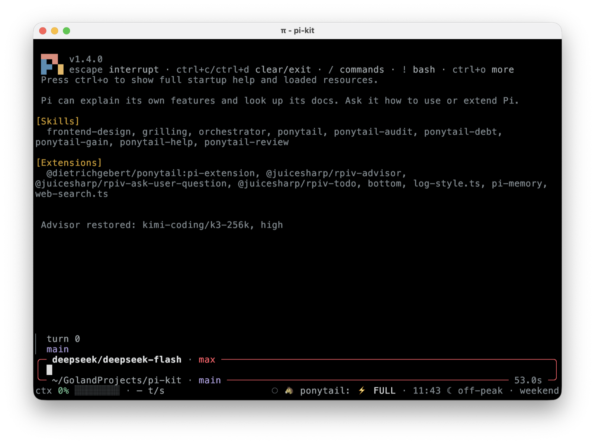
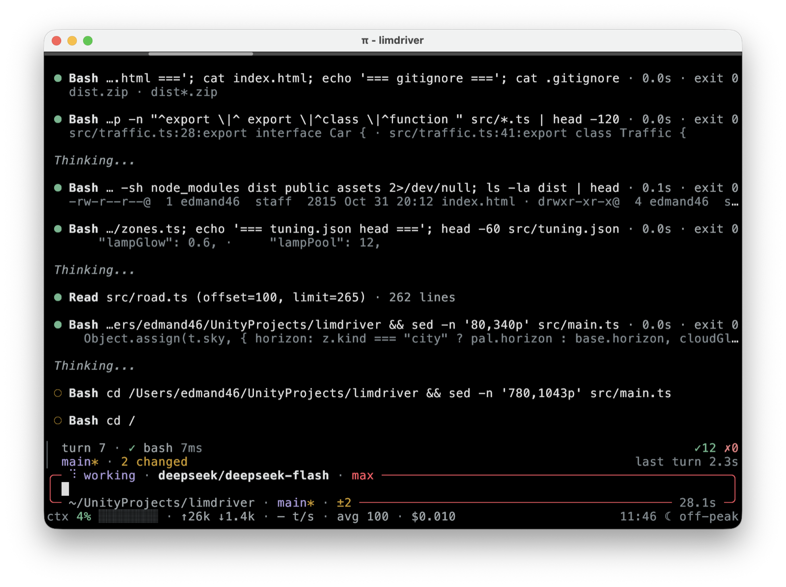

# pi-kit

My [pi](https://github.com/earendil-works/pi-coding-agent) setup as one package: the bottom
chrome, compact tool rows, idle compaction, web search, and the skills I work with.

## Install

```bash
pi install git:github.com/edmand46/pi-kit
```

From a local checkout, so edits apply after `/reload`:

```bash
pi install ./pi-kit
```

`pi list` shows what is installed, `pi remove <source>` drops it, `pi update` reconciles a git
checkout. Restart pi or run `/reload` after installing.

The package declares its resources under `pi` in `package.json`, so nothing is discovered by
convention and nothing outside `extensions/` and `skills/` loads.

## Extensions

### `bottom`

Unified bottom chrome for pi: a dashboard, a framed editor and a one-line status footer that
share the same data and theme. Hides itself on terminals narrower than 80 columns or shorter
than 30 rows.



`/bottom` toggles and configures the pieces, `f2` toggles the dashboard. The full command and
config reference is in [`extensions/bottom/README.md`](extensions/bottom/README.md).

### `log-style`

Replaces the built-in tool call rows for `read`, `bash`, `edit`, `write`, `grep`, `find` and `ls`
with one compact line each — label, target, the facts that matter (`+142 −38`, match counts, line
ranges, exit status) — and keeps the detail behind the usual expand.



### `idle-compact`

Compacts the session when you leave it alone, so the prompt cache is still hot and you come back to
a small context instead of a long one. The timer starts when the agent settles, and any input
resets it.

It compacts once per idle stretch, and only when the context is at least `minTokens` and has grown
since the last idle compact — an empty or already small session is left alone. The summary is
written for continuation: what we are working on, the decisions and why, the files touched, the
next steps and the open questions. Successful compacts leave one dim `idle compact · 15 min idle ·
84k → 12k tokens` line in the transcript; a failed one leaves the error there and is not retried
until you are back. TUI only.

Config is optional and lives in `~/.pi/agent/idle-compact.json`:

```json
{ "idleMinutes": 15, "minTokens": 20000 }
```

### `web-search`

Adds a `web_search` tool returning titles, URLs and snippets. Brave first, DeepSeek as fallback;
`provider` picks one explicitly.

| Key | Where it comes from |
| --- | --- |
| Brave | `BRAVE_SEARCH_API_KEY` in the environment |
| DeepSeek | the pi credential (`pi auth login deepseek`), `DEEPSEEK_API_KEY` as fallback |

## Skills

| Skill | What it does |
| --- | --- |
| `orchestrator` | Plans and verifies in the main session, delegates every change to worker subagents |
| `grilling` | Interviews you through `ask_user_question` in rounds until a plan has no assumptions left |
| `frontend-design` | Aesthetic direction, typography, palette, layout and motion for pages whose look matters |

`orchestrator` needs the `subagent` tool, `grilling` needs `ask_user_question`. `frontend-design`
is vendored from `anthropics/claude-plugins-official` and `anthropics/claude-cookbooks`; its
licenses sit next to the skill.

## Companion packages

These are separate pi packages, installed once into personal settings:

```bash
pi install npm:@juicesharp/rpiv-todo
pi install npm:@juicesharp/rpiv-ask-user-question
pi install npm:@juicesharp/rpiv-advisor
pi install npm:@dietrichgebert/ponytail
pi install npm:pi-memory
```

## Config the package does not carry

`pi install` only manages extensions, skills, prompts and themes. The rest of my setup is
`~/.pi/agent`:

`settings.json` — theme, default model, tool defaults, compaction and the package list:

```json
{
  "theme": "dark",
  "defaultProvider": "deepseek",
  "defaultModel": "deepseek-flash",
  "defaultThinkingLevel": "max",
  "hideThinkingBlock": true,
  "enableInstallTelemetry": false,
  "collapseChangelog": false,
  "packages": [
    "git:github.com/edmand46/pi-kit",
    "npm:@juicesharp/rpiv-todo",
    "npm:@juicesharp/rpiv-ask-user-question",
    "npm:@dietrichgebert/ponytail",
    "npm:pi-memory",
    "npm:@juicesharp/rpiv-advisor"
  ],
  "defaultTools": ["+grep", "+find", "+ls"],
  "compaction": {
    "reserveTokens": 120000,
    "keepRecentTokens": 1000
  }
}
```

`mcp.json` — [Obscura](https://github.com/h4ckf0r0day/obscura) as a headless browser, with the
hot tools loaded directly and the rest behind `tool_search`:

```json
{
  "mcpServers": {
    "obscura": {
      "command": "~/.local/bin/obscura",
      "args": ["mcp", "--stealth", "--allow-private-network"],
      "exposure": "deferred",
      "toolExposure": {
        "browser_navigate": "direct",
        "browser_snapshot": "direct",
        "browser_click": "direct",
        "browser_fill": "direct",
        "browser_evaluate": "direct",
        "browser_screenshot": "direct",
        "browser_markdown": "direct"
      },
      "description": "Headless browser (Obscura): navigate pages, click/fill, screenshots/PDF, console and network inspection."
    }
  }
}
```

`--allow-private-network` lets the browser reach `localhost` and the LAN, which the default
blocks. Drop `--stealth` if a site breaks under its tracker blocking.

`bottom.json` is written by the extension itself and every default lives in the code, so it only
needs to exist to override something:

```json
{
  "enabled": true,
  "dashboard": "auto",
  "dashboardPlacement": "aboveEditor",
  "icons": "unicode",
  "frameEditor": true,
  "spinner": true,
  "show": {
    "ctx": true,
    "tokens": true,
    "cost": true,
    "cache": true,
    "model": true,
    "thinking": true,
    "cwd": true,
    "git": true,
    "session": true,
    "clock": true,
    "tool": true,
    "statuses": true
  }
}
```

`auth.json`, `sessions/`, `models-store.json` and `memory/` stay on the machine.

## License

MIT. The `frontend-design` skill is third-party content under its own licenses, kept in
`skills/frontend-design/`.
